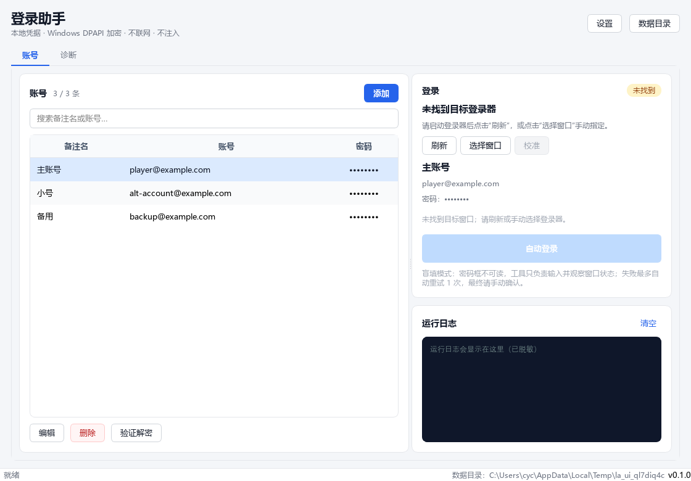
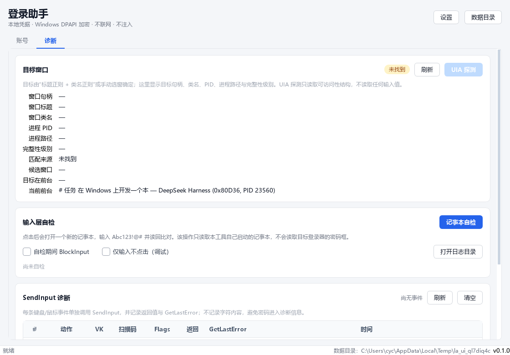

# 登录助手 (Login Assistant)

一个**本地** Windows 桌面小工具：安全保存账号密码，并把凭据自动输入到**已经在运行**的游戏官方登录器窗口，然后尝试点击登录按钮。

> 仅用于你本人拥有、且已在本机登录的账号。工具不联网、不注入、不读取密码框、不绕过反作弊。请在使用前阅读[安全边界](#安全边界)与[已知限制](#已知限制)。





---

## 目录

- [安全边界](#安全边界)
- [功能](#功能)
- [工作原理](#工作原理)
- [环境与安装](#环境与安装)
- [首次使用（校准 → 自检 → 实机）](#首次使用校准--自检--实机)
- [配置](#配置)
- [打包](#打包)
- [测试](#测试)
- [故障排查表](#故障排查表)
- [已知限制](#已知限制)
- [数据与隐私](#数据与隐私)
- [项目结构](#项目结构)
- [开发日志与 PR](#开发日志与-pr)

---

## 安全边界

本工具**只**使用公开的 Win32 / UI Automation API，明确不做以下事情：

- ❌ 不注入 DLL、不 hook、不调试任何进程
- ❌ 不读写其它进程的内存（密码框的值从不读取；账号框仅通过 UIA 属性或 `WM_GETTEXT` 读取长度用于校验，见下）
- ❌ 不修改/绕过反作弊，不伪造设备指纹/机器码，不做驱动
- ❌ 不联网、不上传、不内置遥测
- ❌ 不实现硬件 HID，不实现规避输入注入检测的手段
- ❌ 不修改游戏文件

它不会尝试对抗任何反作弊或输入过滤。如果目标程序拒绝模拟输入，工具只会**报告**这一事实，不会尝试绕过。

---

## 功能

| 编号 | 功能 |
| --- | --- |
| F1 | 账号增/删/改/查；列表显示备注名、账号（明文）、密码（固定长度掩码）；记住上次选中项 |
| F2 | 密码使用 Windows DPAPI `CryptProtectData`（CurrentUser，`CRYPTPROTECT_UI_FORBIDDEN`）加密；落盘只保存 base64 密文；日志/异常/崩溃信息统一脱敏 |
| F3 | 顶层窗口枚举，按配置文件中的“标题正则 + 类名正则”匹配；显示已找到/未找到；支持刷新和手动选窗兜底 |
| F4 | 窗口校验 → 严格抢焦点 → 完整性级别检查 → UIA 或校准定位 → 可选 BlockInput → SendInput 扫描码输入 → 输入后清空内存缓冲 |
| F5 | 盲填结果判定：窗口关闭/按钮禁用/新增错误文本/账号框长度；失败**最多自动重试 1 次**，然后转手动确认；明确密码错误/验证码时不自动重试 |
| F6 | 输入前 `ImmAssociateContext(hwnd, None)` 摘除 IME，结束后恢复 |
| F7 | 诊断面板：目标句柄/标题/PID/完整性级别、UIA 探测、SendInput 每事件返回值与 GetLastError、记事本自检、“仅输入不点击”开关 |
| F8 | 配置：窗口正则、字符延时、BlockInput、自动回车、校准坐标、验证等待、手动目标等 |

---

## 工作原理

### 1. 凭据存储

- `accounts.json` 中密码字段只有 `base64(DPAPI 密文)`；明文密码从不写入磁盘。
- DPAPI 使用 CurrentUser 作用域 + 本应用专用 entropy。密文通常只能由**保存它的 Windows 用户在同一台计算机**上解密。
- 备注名、账号按需求以明文保存（用于列表显示）；日志中不记录账号与密码。
- 解密后的密码只在登录 Worker 线程内以 `bytearray` 短暂存在，输入完成后立即覆写（Python 的 `str`/`bytes` 不可变，因此这是“尽力而为”，详见[已知限制](#已知限制)）。

### 2. 窗口匹配

默认规则（可在“设置 → 窗口匹配”中修改）：

- 标题正则：`(?i)(riot\s*client|valorant|无畏契约|拳头游戏|league\s*client)`
- 类名正则：`(?i)(riot|valorant|cef|chrome_widgetwin|qt\d*|applicationframewindow|unrealwindow)`
- 默认要求**标题和类名同时匹配**，并排除本工具自己的窗口。
- 默认**不**匹配 Avalonia 窗口，避免把标题恰好是仓库名的源码管理工具（如 SourceGit）误认成登录器。
- 如果你的登录器本身就是 Avalonia（类名以 `Avalonia-` 开头），请把 `avalonia` 加入类名正则，或使用“选择窗口”手动指定。

正则匹配不到时，可以点击“选择窗口”手动指定。手动目标保存为“标题 + 类名 + 进程路径”签名；窗口关闭后签名失效，可重新选择或清除。

### 3. 定位输入框

优先级：

1. **UI Automation**：在目标窗口下查找 `Edit` 控件，按 `IsPassword`、名称/自动化 ID 与相对位置区分账号框/密码框；登录按钮按名称与“位于密码框下方”选择。取 `BoundingRectangle` 中心点击。
2. **校准模式**：依次点击账号框、密码框、登录按钮三次，记录相对客户区的**物理像素**坐标。遮罩自己接收点击，不使用全局鼠标 hook。
3. 两者都不可用时**报错中止**，不会在猜测的坐标上乱点。

UIA 探测只读取控件的名称、类型、矩形、是否密码框、是否启用等可访问性属性，**不读取密码框的值**。

### 4. 输入

- 使用 `SendInput` + `KEYEVENTF_SCANCODE`。
- `VkKeyScanExW(ch, 目标线程键盘布局)` 取得 VK 与 Shift 状态；`MapVirtualKeyExW` 取得扫描码。
- Shift 组合按 down → tap → up；每字符间隔默认 40~80 ms 随机抖动。
- 输入前点击目标框（三击以尽量全选），用 Ctrl+A + Backspace + Delete 清空；输入账号 → 密码 → 点击登录按钮或 Enter。
- 可选 `BlockInput(True)`（在工作线程内调用，`try/finally` 恢复；线程退出时 Windows 也会自动解除）。
- 输入前摘除 IME，结束后恢复。
- 输入完成后立即覆写密码 `bytearray`。
- **只支持 ASCII 可打印字符**（A-Z a-z 0-9 及常见英文符号）。中文、Emoji 等无法用扫描码可靠输入，界面会提示，实机登录会报错要求手动输入。

### 5. 结果判定（盲填）

密码框不可读，因此本工具**不会断言登录成功**。提交后观察：

- 窗口是否关闭/最小化/标题变化
- 登录按钮是否变为禁用
- 是否出现新的错误/验证码文本
- 账号框长度是否与输入长度一致（只读非密码框；用于区分“密码错误”和“输入被拒绝”）

判定为“失败最多自动重试 1 次”：

- **明确密码/账号错误、验证码/二次验证**：不自动重试，直接提示手动处理（避免风控计数）。
- **不确定/输入未送达**：允许自动重试 1 次；仍不确定则提示“请手动确认”。
- **窗口关闭**：可能成功，也可能登录器崩溃，仍要求手动确认。

> 关键区分：`SendInput` 返回 1，但账号框一直为空、且没有密码错误提示 → 更可能是目标程序拒绝了模拟输入（例如低级键盘钩子检查 `LLKHF_INJECTED`），而不是密码错误。工具会明确提示这一点。

---

## 环境与安装

- Windows 10/11 x64
- Python 3.11+（开发验证使用 3.13）
- PySide6（唯一的运行期第三方依赖）
- 打包：PyInstaller

```bat
py -3.13 -m pip install -r requirements.txt
py -3.13 -m login_assistant
:: 或
run_dev.bat
```

运行期不发起任何网络请求。打包时可通过 `--exclude-module PySide6.QtNetwork` 进一步裁掉 Qt 网络模块（`build.bat` 已包含）。

---

## 首次使用（校准 → 自检 → 实机）

建议严格按顺序执行；第一步不通过就不要继续。

### 0. 启动

双击 `dist\LoginAssistant.exe`（无控制台窗口），或源码运行。主界面应在几秒内出现。

### 1. 添加账号

1. 点击“添加”。
2. 填写备注名、账号、密码。
3. 保存。列表只显示固定长度掩码；可用“验证解密”确认 DPAPI 解密成功（不显示明文）。
4. 重启程序，确认密码仍能解密。

### 2. 找到目标窗口

1. 先启动游戏官方登录器，停在登录界面。
2. 回到本工具，点击“刷新”。
3. 状态应显示“已找到”，并显示 HWND / PID / 类名 / 完整性级别。
4. 若显示“未找到”：检查设置中的正则，或点击“选择窗口”手动选中登录器。

### 3. 校准（UIA 找不到控件时的兜底）

1. 确保登录器窗口完整可见、未最小化。
2. 点击“校准”。
3. 主窗口隐藏后，按顺序点击：账号框 → 密码框 → 登录按钮。
4. 每次点击只记录坐标，不会传给登录器；按 Esc 取消。
5. 校准保存的是相对客户区的物理像素坐标；窗口尺寸/位置变化后需要重新校准。

> 建议先尝试直接登录（UIA）。只有 UIA 探测显示 0 个 Edit 或找不到登录按钮时，才需要校准。

### 4. 记事本自检（隔离输入层问题）

1. 在“诊断”页点击“记事本自检”。
2. 工具会打开一个新的记事本，输入 `Abc123!@#`，读回并比对。
3. **必须从本工具界面点击自检按钮**。Windows 有前台锁：一个后台进程（例如命令行脚本）通常无法把记事本抢到前台；界面点击时本工具是前台进程，才符合 `SetForegroundWindow` 的规则。
4. 自检会保留记事本窗口，方便人工核对；不会保存或修改你的文件。
5. 如果回显不一致：先排查键盘布局、安全软件拦截、焦点问题，不要继续实机登录。

### 5. 实机登录

1. 选中账号，确认目标状态“已找到”。
2. 点击“自动登录”。
3. 工具会：抢焦点 → 点击账号框 → 输入账号 → 点击密码框 → 输入密码 → 点击登录/Enter → 观察结果。
4. **登录期间主窗口会自动最小化**，避免主窗口与登录器抢前台；结果对话框出现前自动恢复。
5. 根据结果提示手动确认。失败最多自动重试 1 次；明确密码错误/验证码时不会自动重试。
6. 若提示“目标程序可能拒绝了模拟输入”，请停止反复尝试，手动登录。
7. 若提示“前台焦点被其他窗口抢占”，结果详情会显示抢占窗口的标题/类名/PID；关闭该窗口或重新校准后重试。工具会先尝试重新聚焦目标，不会直接判定是你移动了鼠标。

### 5.1 密码框拒绝模拟输入时（实验）

如果账号能输入、密码框有光标但始终为空，说明密码控件可能过滤了 `SendInput`。可以试 UIA 写入：

1. 打开“诊断”页，点 **“密码框 UIA 写入探测”**。它只检查 ValuePattern 是否可用/是否只读，**不读取也不写入密码**。
2. 若结果显示“可写”，到“设置 → 输入”勾选 **“密码用 UIA ValuePattern 写入（实验，非键盘）”** 并保存。
3. 重新自动登录。

注意：这不是键盘模拟，而是通过 Windows 无障碍接口直接写控件；控件可能拒绝，失败会明确报错。密码值不会写入日志。若探测显示“不支持/只读”，只能手动输入密码。该方式可能触及启动器/游戏的自动化条款，风险自负。

### 6. 调试开关

- **仅输入不点击**：输入账号与密码，但不点击登录按钮、也不自动重试。仍会点击输入框用于定位；用于确认“输入层是否正常”。
- **BlockInput**：输入期间屏蔽物理键鼠。高风险可选；异常时由 `finally` 和工作线程退出自动恢复。建议只在确认环境时开启。

---

## 配置

位置：`%LOCALAPPDATA%\LoginAssistant\config.json`（不含密码）。

| 字段 | 说明 |
| --- | --- |
| `window_match.title_regex` | 标题正则 |
| `window_match.class_regex` | 类名正则 |
| `window_match.exclude_title_regex` | 排除正则（默认排除本工具） |
| `window_match.process_regex` | 可选：按进程完整路径过滤 |
| `window_match.require_both` | 是否要求标题和类名同时匹配 |
| `input.delay_min_ms` / `delay_max_ms` | 每字符随机间隔（0~1000 ms） |
| `input.block_input` | 是否在输入期间 BlockInput |
| `input.password_use_uia` | 密码用 UIA ValuePattern 写入（实验，非键盘） |
| `input.auto_enter` | 找不到登录按钮时是否用 Enter 提交 |
| `input.input_only_no_click` | “仅输入不点击”调试开关 |
| `input.verify_wait_ms` | 提交后观察窗口状态的时间（800~15000 ms） |
| `input.retry_cooldown_ms` | 重试前等待 |
| `input.max_attempts` | 固定上限 2（即最多 1 次自动重试） |
| `calibration.*` | 账号框/密码框/登录按钮的相对坐标与客户区尺寸 |
| `manual_target` | 手动选窗签名（标题/类名/进程路径） |
| `last_selected_id` | 上次选中的账号 ID |
| `window_geometry_b64` | 主窗口位置 |

配置文件损坏时会备份为 `config.json.corrupt-<时间戳>` 并使用默认值；账号文件也是类似策略，覆盖前保留 `accounts.json.bak`。

---

## 打包

```bat
build.bat
```

脚本会：

1. 检查/安装 PySide6 与 PyInstaller（依赖已安装时跳过网络安装）；
2. 运行 65 个单元测试；
3. 使用 `LoginAssistant.spec` 以 `--onefile --windowed` 打包，并过滤掉未使用的 Qt DLL/插件
   （`opengl32sw.dll`、QtQuick/Qml/Pdf/Network、翻译、图片格式插件等）；
4. 用 `QT_QPA_PLATFORM=offscreen` 对打包后的 EXE 做离屏冒烟测试；
5. 输出 `dist\LoginAssistant.exe`。

产物：

- 单文件、无控制台窗口；
- 图标与版本信息来自 `assets/app.ico`、`build_support/version_info.txt`；
- 已排除 QtWebEngine/QtNetwork 等未使用的大模块（若你的目标机器缺少某些 Qt 插件，可自行调整 `build.bat` 的 `--exclude-module`）。

`run_tests.bat` 只跑测试。

> 冷启动时间受单文件解压、杀软扫描和磁盘速度影响。验收要求 < 3 秒；开发机（SSD，22MB EXE）离屏测量：首次约 2.9 秒、后续约 2.3 秒（已扣除冒烟测试固定 0.9 秒等待；应用初始化约 0.5 秒）。若你的机器较慢，可将 EXE 加入杀软排除项，或自行改为 `--onedir`（本项目按需求使用 onefile）。

---

## 测试

```bat
run_tests.bat
:: 或
py -3.13 -m unittest discover -s tests -v
```

覆盖：

- DPAPI 加解密往返、篡改密文失败、错误 entropy 失败；
- 字符 → (VK, Shift, 扫描码) 映射：A-Z/a-z/0-9/常见符号；`?` 扩展键回归；
- 账号存储：增删改查、重启解密、落盘无明文、损坏文件备份、版本只读保护；
- 日志脱敏：`password=`、`密码：`、异常 traceback；
- 窗口匹配：Riot/Valorant 命中、SourceGit 误报防护、手动目标优先；
- 结果判定：窗口关闭、密码错误、验证码、按钮禁用、输入未送达、部分输入、标题变化、不确定；
- 运行期无网络库导入、requirements 只含 PySide6。

**注意**：`test_no_network.py` 只扫描 import，不会发起网络请求。

---

## 故障排查表

| 现象 | 可能原因 | 处理 |
| --- | --- | --- |
| 找不到窗口 | 正则不匹配；类名不同；窗口被 DWM cloak；多候选 | 用“设置 → 测试规则”查看命中；改用“选择窗口”手动指定；确认登录器在前台且可见 |
| 找到了但点“自动登录”没反应 | 目标最小化/禁用/hung；焦点被抢；工具被 UIPI 拦截 | 还原窗口；关闭全屏游戏/前台锁；查看诊断面板与日志 |
| 提示“前台焦点被其他窗口抢占” | 主窗口/其他应用/CEF 弹层短暂抢焦点；校准点落在错误控件 | 工具会先尝试重新聚焦，并在结果详情显示抢占窗口的标题/类名/PID；登录期间主窗口会自动最小化；关闭抢占窗口或重新校准 |
| 提示“校准坐标当前不在目标窗口上” | 坐标落在无关窗口/控件；登录器被遮挡或窗口尺寸变化 | 新版会接受目标子进程（如腾讯 `TASLogin64.exe`）里的 Edit；若仍报错，关闭遮挡窗口、还原登录器尺寸后重新校准 |
| 完整性级别高于本工具 | 登录器以管理员/更高完整性运行 | 右键“以管理员身份运行”本工具；若仍失败，目标可能是受保护进程 |
| `SendInput` 返回 0，`GetLastError=5` | UIPI 权限不足 | 以管理员身份运行；检查目标完整性级别 |
| `SendInput` 返回 1，但账号框无任何字符 | 目标装了低级键盘钩子并检查 `LLKHF_INJECTED`；焦点不对；IME/自绘控件；键盘布局不匹配 | 先做记事本自检；确认焦点；检查 IME；用 UIA 探测看控件；校准；不要反复尝试 |
| 密码框始终为空 / 密码输不进去 | 密码控件是只读/`WS_EX_NOACTIVATE`/安全控件，或只过滤密码框的注入输入 | 新版会在点击后强制聚焦密码控件，并记录 `ES_PASSWORD`/`readonly`/`NOACTIVATE`；若只读或拒绝注入，工具无法安全绕过，请手动输入密码（不要用粘贴绕过） |
| 记事本自检“抢焦点失败” | 从命令行/后台进程运行时受 Windows 前台锁限制 | **从本工具界面点击自检按钮**；关闭全屏游戏；不要从脚本调用 |
| UIA 探测 Edit=0 | CEF/自绘/无 UIA 支持的登录器 | 使用校准模式 |
| 校准后点击位置偏移 | 窗口尺寸/位置/DPI 变化 | 重新校准；保持窗口大小不变；确认 Per-Monitor V2 |
| 登录失败但无错误文本 | 盲填无法读取密码框；提示延迟；风控 | 只重试 1 次后手动确认；不要连续点击；检查账号密码 |
| 出现“验证码/二次验证” | 风控/人机验证 | 手动完成；工具不会绕过 |
| 密码无法解密 | 换了 Windows 用户/计算机；密文损坏 | 用原用户原机；从 `accounts.json.bak` 恢复；重新录入 |
| 杀软误报 | PyInstaller onefile 自解压 | 从源码构建；对 `dist\LoginAssistant.exe` 加白；不要下载不明二进制 |
| 冷启动 > 3 秒 | onefile 解压 + 杀软扫描 | 加杀软排除；用 SSD；或自行改为 onedir |
| 输入的字符不对 | 目标键盘布局与预期不一致；非 ASCII 字符 | 使用英文布局；只使用 ASCII 可打印字符；先用记事本自检 |

### 关于“有返回但无输入”

这是最关键的风险场景。工具会：

1. 记录每次 `SendInput` 的返回值和 `GetLastError`（诊断面板）；
2. 在提交前读取**非密码**账号框长度；
3. 若长度仍为 0，判定“目标程序可能拒绝了模拟输入”，不会把它当成密码错误；
4. 最多重试 1 次，然后要求手动确认。

它不会尝试 hook、驱动、硬件 HID 或任何绕过输入检测的方法。

---

## 已知限制

1. **盲填**：密码框不可读，工具无法确认密码是否真的输入成功；结果判定只是倾向性提示。
2. **仅 ASCII**：扫描码方案无法可靠输入中文/Emoji；界面会警告，实机会报错。
3. **键盘布局**：扫描码按目标线程键盘布局换算；若目标布局与预期不同，字符可能不一致。请用英文布局并先做记事本自检。
4. **注入标志**：`SendInput` 事件带 `LLKHF_INJECTED`；目标若检查该标志，会静默丢弃。工具只能报告，不会绕过。
5. **焦点**：Windows 前台锁可能阻止抢焦点；必须从本工具界面发起操作。
6. **UIA 覆盖**：部分登录器（CEF/自绘/游戏引擎 UI）不暴露 Edit；需要校准。
7. **内存清理**：Python 字符串不可变，DPAPI 返回的 bytes 也会短暂存在；`bytearray` 覆写是尽力而为，无法达到 C 程序级别的保证。
8. **onefile**：首次启动需要解压到临时目录，冷启动时间和杀软误报率均高于 onedir。
9. **密码框清空**：校准/UIA 依赖三击 + Ctrl+A/Backspace/Delete；极少数自绘控件可能不支持全选，导致重试时追加字符。请先在安全的测试窗口验证。
10. **不保证成功**：网络、风控、验证码、服务端状态都可能让登录失败；工具不会持续重试。
11. **密码控件可能拒绝注入**：账号框能输入不代表密码框也能输入。部分登录器（如腾讯 `TASLogin64.exe`）的密码控件可能是只读、`WS_EX_NOACTIVATE` 或专门过滤模拟输入；工具会记录样式/焦点并明确报告，但不会 hook、驱动或绕过检测。遇到这种情况只能手动输入密码。

---

## 数据与隐私

| 文件 | 内容 |
| --- | --- |
| `%LOCALAPPDATA%\LoginAssistant\accounts.json` | 备注名、账号（明文）、密码（DPAPI 密文 base64）、时间戳 |
| `accounts.json.bak` | 上次覆盖前的密文备份 |
| `config.json` | 正则、延时、校准坐标、手动目标签名、窗口位置；**不含密码** |
| `logs\app.log` | 运行日志（滚动 3 份），统一经过脱敏 formatter |
| `app.lock` | 单实例锁 |

- 无网络、无遥测、无上传。
- 日志中不记录账号/密码；异常 traceback 也不包含局部变量。
- “验证解密”只显示明文长度，不显示密码。
- 复制功能只复制账号，不复制密码。

> 账号文件中的账号按需求是明文。若你的账号本身也是敏感信息，请自行用 BitLocker/EFS 保护整个用户目录。

---

## 项目结构

```
login_assistant/
  app.py                 应用入口（DPI、单实例、日志、异常钩子）
  config.py              配置读写与校验
  logging_setup.py       日志/脱敏/全局异常
  security/
    dpapi.py             CryptProtectData / CryptUnprotectData
    redact.py            日志脱敏
    secret.py            bytearray 覆写
  core/
    models.py            数据类（无密码字段）
    store.py             账号 JSON + DPAPI 存储
    keymap.py            字符 -> VK/Shift/扫描码
    input.py             SendInput 键盘/鼠标 + 诊断事件
    winapi.py            窗口/焦点/完整性/IME/BlockInput/DPI
    uia.py               IUIAutomation COM 客户端（ctypes）
    windowmatch.py       标题/类名正则匹配
    verify.py            盲填结果判定
    automation.py        登录编排（线程内完成）
    selftest.py          记事本自检
  ui/
    main_window.py       主窗口
    account_dialog.py    账号编辑
    settings_dialog.py   设置
    manual_target_dialog.py
    calibration.py       校准遮罩
    diagnostics.py       诊断面板
    login_worker.py      登录 QThread
    logpanel.py          日志面板
    theme.py / widgets.py / icon.py
tools/
  selftest_input.py      命令行自检（需要可用的前台桌面）
  mock_login.py          本机 Win32 模拟登录窗口（仅开发测试）
  ui_snapshot.py         离屏 UI 截图（不显示窗口）
tests/                   65 个单元测试
LoginAssistant.spec      PyInstaller 打包配置（过滤未使用 Qt DLL/插件）
build.bat / run_dev.bat / run_tests.bat
```

> `tools/mock_login.py` 是一个**测试靶子**：原生 Win32 窗口，输入 `test` / `Abc123!@#` 显示成功；其它组合显示密码错误。它不参与打包。可以用它安全地验证 UIA/校准/结果判定，而不必拿真实账号冒险。

---

## 开发日志与 PR

- 阶段改动、验证命令与结果：见 [`CHANGELOG.md`](CHANGELOG.md) 与 [`docs/DEVLOG.md`](docs/DEVLOG.md)。
- 本仓库按阶段创建 PR；每个 PR 描述包含该阶段范围、验证结果和已知问题。

---

## 免责声明

本项目按“现状”提供，不保证适用于所有登录器，也不保证登录一定成功。使用本工具可能违反某些游戏的服务条款；请自行评估风险。作者不对账号封禁、数据丢失或其它后果负责。请优先使用官方提供的“记住密码”等功能。
